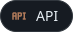
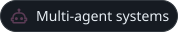
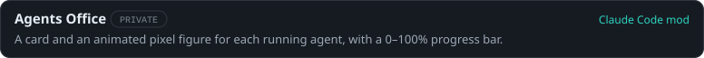
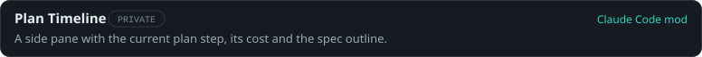
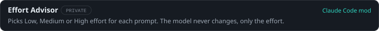

# Saharat Plypech `v1.1.5`

Passionate developer who loves to create and learn new things. Currently working on projects that push the boundaries of what's possible with code.

## Current release

 IoT Development and Multi-Agent System Lead at **AltoTech Global** 
 AI, IoT and software development 
 Constantly learning and exploring new technologies

## Dependencies

  
  
  
  

  
  
  
  
  
  
  

  
  
  
  

  
  
  
  

  
  
  
  

  
  
  
  

  
  
  

## Telemetry

  
  

  

<!-- Trophies and activity graph: their public hosts return "402 DEPLOYMENT_DISABLED" (checked 2026-10-25). Re-enable once self-hosted.

-->

<picture>
  <source media="(prefers-color-scheme: dark)" srcset="https://raw.githubusercontent.com/Saharatjj/Saharatjj/output/github-snake-dark.svg">
  <source media="(prefers-color-scheme: light)" srcset="https://raw.githubusercontent.com/Saharatjj/Saharatjj/output/github-snake.svg">
  
</picture>

## Previous releases

  
<b>Education</b> · Bachelor of Mechanical Engineering, Chulalongkorn University

   
  University projects live in <a href="https://github.com/Saharatjj/CU-Project">CU-Project</a>: a Python game, Raspberry Pi and ESP32.

## Release notes

## Support

  
  
  

<!---
Saharatjj/Saharatjj is a ✨ special ✨ repository because its `README.md` (this file) appears on your GitHub profile.
You can click the Preview link to take a look at your changes.
--->
